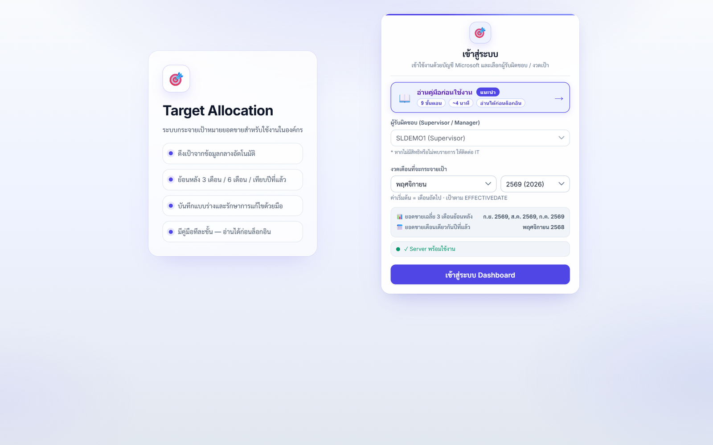
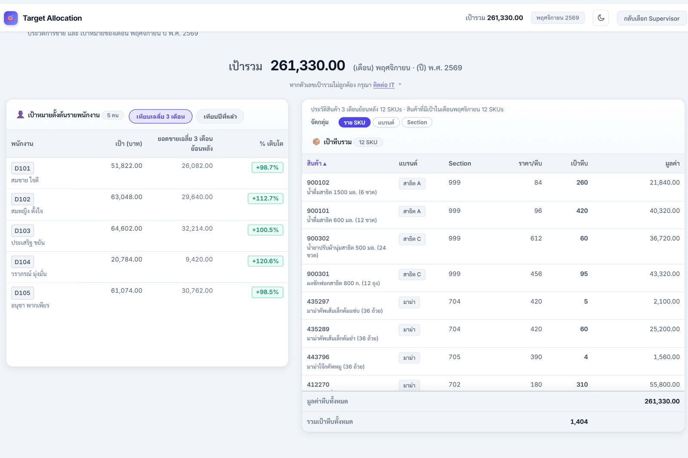
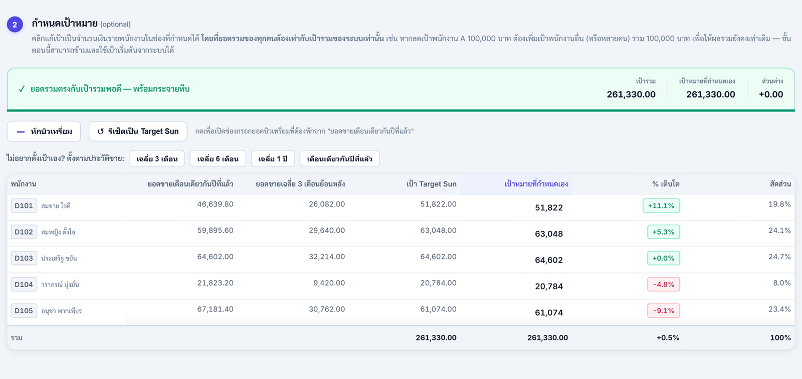
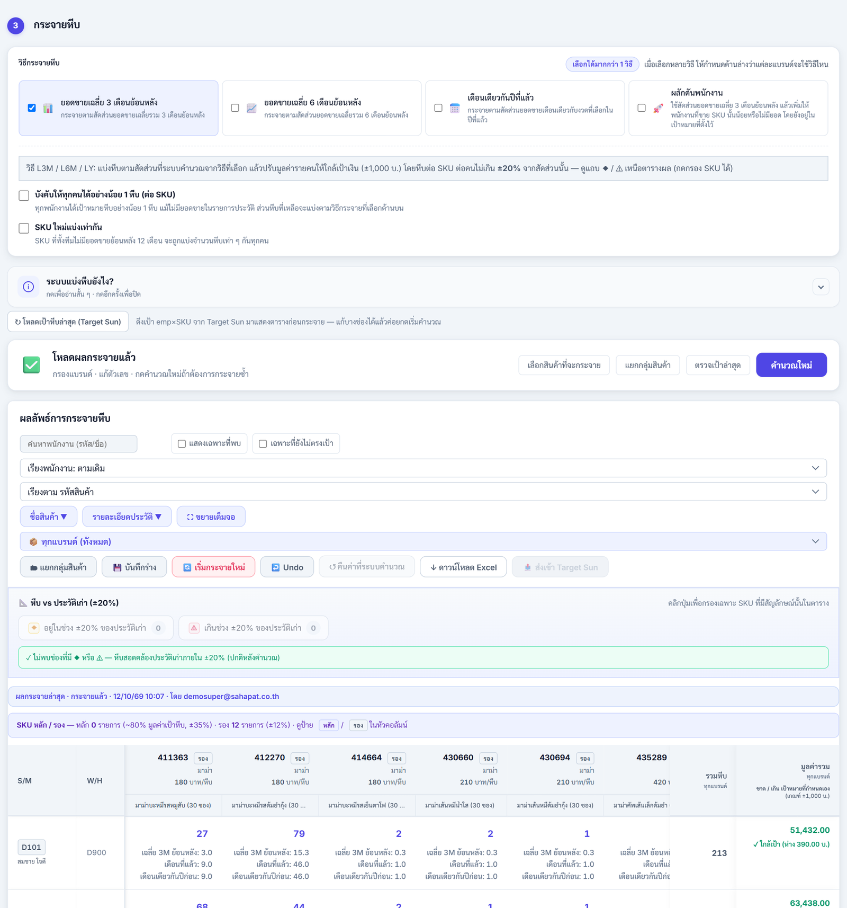
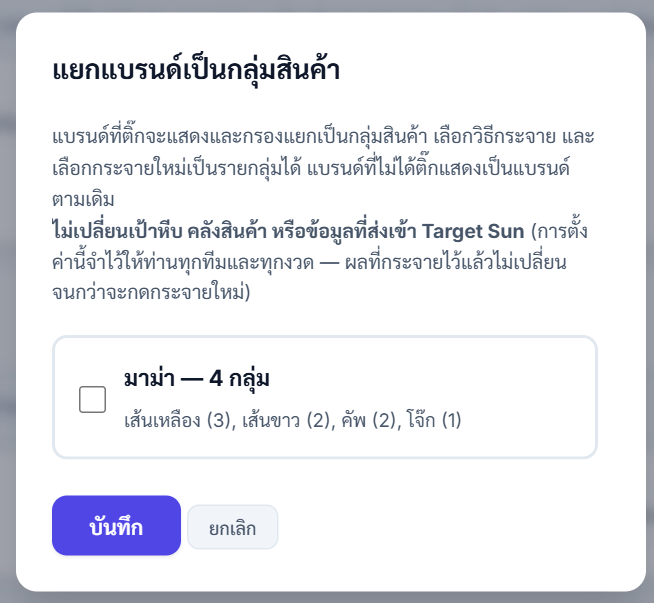
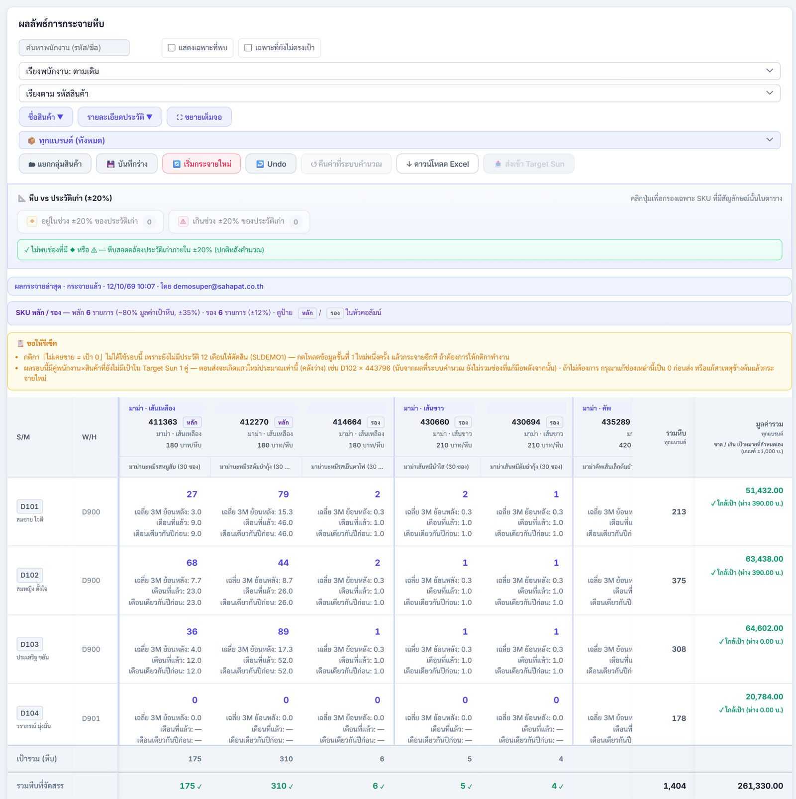
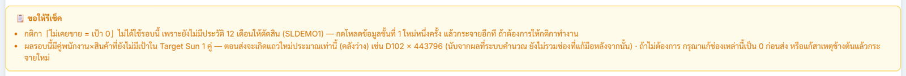
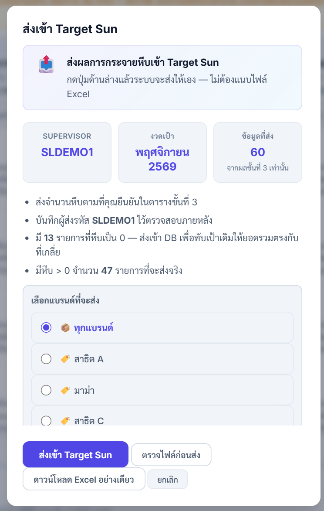

# คู่มือการใช้งาน Target Allocation

**ระบบกระจายเป้าหมาย (หีบ) ให้พนักงานขายรายคน**

คู่มือนี้สำหรับ **หัวหน้าทีมขาย (Supervisor) และผู้จัดการ** ที่ใช้ระบบตั้งเป้าหีบให้พนักงานในทีม
อ่านตามลำดับทีละขั้นได้เลย ทุกขั้นมีภาพหน้าจอประกอบ · ใช้เวลาอ่านประมาณ 15 นาที

---

## 0. ก่อนเริ่มใช้งาน (อ่านก่อน — สำคัญ)

- **เปิดระบบครั้งแรกหลังมีการปรับปรุง ให้กด Ctrl + F5** (Mac: Cmd + Shift + R) หนึ่งครั้ง เพื่อโหลดหน้าจอรุ่นล่าสุด
- **เป้างวดใหม่จะเข้าระบบประมาณวันที่ 15 ของเดือน** — ถ้าขึ้น「ระบบยังไม่อัปเดตเป้า」แปลว่ายังไม่มีเป้างวดนั้น **ให้รอ** ไม่ใช่ระบบเสีย
- ตอนเข้าระบบ ตรวจว่าเลือก **งวดเดือนที่จะทำเป้า** ถูกต้อง (ปกติคือเดือนถัดไป)
- แก้เป้าเงินในขั้นที่ 2 แล้ว **ต้องกด「คำนวณใหม่」ในขั้นที่ 3 ทุกครั้ง**
- **คลิกช่องหีบแล้วไม่ได้แก้เลข = ล็อกช่องนั้นไว้** ถ้าไม่ได้ตั้งใจ กดปุ่ม ↺ ในช่องเพื่อปลดล็อก
- ก่อนส่ง ดูแถวล่างสุดของตาราง **ทุกสินค้าต้องเป็น ✓ สีเขียว** (หีบรวม = เป้า) และอ่านแผง **📋 ขอให้รีเช็ค** ให้ครบ
- ในหน้าต่างส่ง ตรวจ **รหัสทีม · งวด · ปลายทาง「ระบบจริง (Prod)」สีเขียว** ก่อนกดส่ง
- กดส่ง **ครั้งเดียว** แล้วรอจนขึ้นกล่อง「✅ ส่งเข้า Target Sun เรียบร้อยแล้ว」 **ห้ามปิดหน้า ห้ามกดซ้ำ**
- **ผู้จัดการภาค:** ตกลงกับหัวหน้าทีมก่อนเสมอว่า **ใครเป็นคนส่ง** อย่าแก้หรือส่งทีมที่หัวหน้าทีมกำลังทำอยู่
- เจอปัญหา กดปุ่ม **💬 ส่งความเห็น** มุมขวาล่าง (ระบบแนบชื่อทีมและงวดให้อัตโนมัติ)

---

## 1. ภาพรวม — ทำอะไรบ้าง

| ขั้น | ทำอะไร | ใช้เวลาโดยประมาณ |
|------|--------|-----------------|
| **เข้าสู่ระบบ** | ล็อกอิน Microsoft → เลือกทีมและงวด | 1 นาที |
| **ขั้นที่ 1 ข้อมูลตั้งต้น** | ตรวจเป้ารวม รายชื่อพนักงาน และเป้าหีบต่อสินค้า (ระบบดึงจาก Target Sun ให้เอง) | 2 นาที |
| **ขั้นที่ 2 เป้าเงินรายคน** | ใช้ตามที่ระบบให้มา หรือปรับเป้าเงินของแต่ละคน (ข้ามได้) | 0–10 นาที |
| **ขั้นที่ 3 กระจายหีบ** | เลือกวิธีกระจาย → กดเริ่มคำนวณ → ตรวจ/แก้ตาราง | 5–15 นาที |
| **ส่งเข้า Target Sun** | ตรวจครั้งสุดท้าย → กดส่งครั้งเดียว | 1–3 นาที |

> **หลักสำคัญของระบบ:** หีบรวมของแต่ละสินค้าที่ส่งเข้า Target Sun จะ **เท่ากับเป้าหีบที่ได้รับมาเสมอ**
> ระบบเพียงแบ่งให้พนักงานแต่ละคน — ถ้ายอดไม่ตรงแม้ 1 หีบ ระบบจะไม่ให้ส่ง

---

## 2. เข้าสู่ระบบ

1. เปิดหน้าระบบ: [https://spc-ai.sahapat.com/allocation_target/](https://spc-ai.sahapat.com/allocation_target/)
2. (แนะนำ) กด **อ่านคู่มือก่อนใช้งาน** บนการ์ดเข้าสู่ระบบ — อ่านได้ก่อนล็อกอิน
3. กด **ล็อกอินด้วย Microsoft** ด้วยบัญชีองค์กร (เปิดครั้งต่อไปไม่ต้องล็อกอินซ้ำ จนกว่าจะหมดเวลา)
4. รอช่อง **ผู้รับผิดชอบ (Supervisor / Manager)** โหลดเสร็จ แล้วเลือกรหัสทีมของท่าน
5. เลือก **งวดเดือน** และ **ปี** ที่จะกระจายเป้า (ค่าเริ่มต้นคือเดือนถัดไป)
6. กด **เข้าสู่ระบบ Dashboard**

- **ไม่พบรหัสทีมของท่านในรายการ** — ท่านยังไม่มีสิทธิ์ใช้ทีมนั้น กรุณาแจ้งผู้ดูแลระบบ
- **ใช้งานนาน ๆ แล้วขึ้นว่าหมดเวลาเข้าสู่ระบบ** — กดล็อกอินใหม่ งานที่บันทึกไว้ไม่หาย
- ปุ่ม **💬 ส่งความเห็น** มุมขวาล่าง ใช้แจ้งปัญหา/ขอให้เพิ่ม/สงสัย ได้ทุกหน้า

---

## 3. ขั้นที่ 1: ข้อมูลตั้งต้น

ระบบดึงเป้าจาก Target Sun และประวัติการขายมาให้อัตโนมัติ ท่านมีหน้าที่ **ตรวจว่าข้อมูลถูกต้อง**

1. ดู **เป้ารวม (บาท)** ด้านบน — ยอดเงินรวมของงวดที่เลือก
2. ตรวจตาราง **พนักงาน** — รหัส ชื่อ และเป้าเริ่มต้นของแต่ละคน
3. ตรวจตาราง **สินค้า (เป้าหีบ)** — รหัสสินค้า แบรนด์ และจำนวนหีบเป้ารวมของแต่ละสินค้า
4. ดูแบบจัดกลุ่มได้: **ราย SKU · แบรนด์ · กลุ่มสินค้า**
5. อ่านกล่อง **「พบข้อมูลที่ควรตรวจสอบ」** (ถ้ามี) เช่น
   - **สินค้าที่ไม่เคยขายเลย — อาจเป็นรหัสใหม่แทนรหัสเก่า?** ถ้าเป็นรหัสใหม่ที่มาแทนรหัสเก่า แจ้งแอดมินให้ผูกรหัส แล้วกด **↻ ดึงข้อมูลใหม่**
   - **ใช้ราคาเครดิตแทนราคารถเงินสด** (ทีมรถเงินสด) — ระบบดึงราคาเงินสดไม่ได้ชั่วคราว กด ↻ ดึงข้อมูลใหม่ภายหลัง
   - **พนักงานอยู่ในสองทีม** — แจ้งแอดมินให้จัดให้อยู่ทีมเดียว

> ถ้าเป้าใน Target Sun เพิ่งถูกปรับ ให้กด **↻ ดึงข้อมูลใหม่** เพื่อโหลดเป้าล่าสุด

---

## 4. ขั้นที่ 2: กำหนดเป้าเงินรายคน (ข้ามได้)

ขั้นนี้ใช้ปรับ **เป้าเงิน (บาท) ของแต่ละคน** ระบบจะใช้เป้าเงินนี้ช่วยตัดสินว่าใครควรได้หีบเท่าไร
ถ้าใช้เป้าตามที่ระบบให้มา **ข้ามขั้นนี้ได้เลย**

1. ดูคอลัมน์ **เป้าหมายที่กำหนดเอง** (ค่าเริ่มต้นเท่าเป้าจาก Target Sun)
2. คลิกช่องแล้วพิมพ์เป้าเงินใหม่ (ถ้าต้องการ) — ระบบคำนวณ **% เติบโต** ให้เอง
3. ตรวจ **ยอดรวมเป้าที่กำหนดเอง** ด้านล่าง ต้องใกล้เป้ารวม

| ส่วนต่างจากเป้ารวม | ความหมาย |
|---------------------|----------|
| ไม่เกิน ~10 บาท | พร้อมกด **เริ่มคำนวณ** |
| ไม่เกิน ~99 บาท | มีคำเตือน แต่ยังกดคำนวณได้ |
| มากกว่านั้น | ปุ่ม **เริ่มคำนวณ** กดไม่ได้ — ต้องปรับให้รวมใกล้เป้ารวม |

**ตัวช่วย**

- **รีเซ็ตเป็น Target Sun** — คืนเป้าทุกคนเป็นค่าเดิม
- **ตั้งตามประวัติขาย** (เฉลี่ย 3 เดือน / 6 เดือน / 1 ปี / เดือนเดียวกันปีที่แล้ว) — สำหรับผู้ที่ไม่อยากตั้งเป้าเอง
  ระบบแบ่งเป้ารวมเดิมให้แต่ละคนตามสัดส่วนยอดขายในช่วงที่เลือก (ยอดรวมยังเท่าเดิม)
  - คนที่ **ไม่มีประวัติขาย** (เช่นพนักงานใหม่) จะได้ **0** และมีป้าย「ไม่มีประวัติ — กรอกเอง」 ต้องพิมพ์เป้าให้เอง
    ถ้าไม่กรอก คนนั้นจะไม่ได้หีบเลย (ระบบถามยืนยันอีกครั้งตอนกดคำนวณ)
  - สินค้าตามฤดูกาล แนะนำ **เดือนเดียวกันปีที่แล้ว**
- **หักบิวเทรี่ยม** — หักยอดจากยอดปีที่แล้วก่อนคิด % เติบโต (ใส่เฉพาะคนที่ต้องหัก)

**ถ้า % เติบโตติดลบ** ระบบจะขอ **เหตุผล** อย่างน้อย 8 ตัวอักษรก่อนกดคำนวณ
(ถ้าเป้าเท่า Target Sun อยู่แล้วไม่ต้องกรอก)

---

## 5. ขั้นที่ 3: กระจายหีบ

### 5.1 เลือกวิธีกระจาย

| วิธี | ความหมาย |
|------|----------|
| **ยอดขายเฉลี่ย 3 เดือนย้อนหลัง** | แบ่งตามสัดส่วนยอดขาย 3 เดือนล่าสุด (ค่าเริ่มต้น) |
| **ยอดขายเฉลี่ย 6 เดือนย้อนหลัง** | แบ่งตามสัดส่วนยอดขาย 6 เดือน |
| **เดือนเดียวกันปีที่แล้ว** | แบ่งตามยอดเดือนเดียวกันของปีก่อน (เหมาะกับสินค้าตามฤดูกาล) |
| **ผลักดันพนักงาน** | ให้สัดส่วนมากขึ้นกับคนที่ขายสินค้านั้นน้อย |

- เลือกได้ **มากกว่า 1 วิธี** — ระบบจะให้กำหนดว่า **แบรนด์ (หรือกลุ่มสินค้า) ไหนใช้วิธีไหน** ในกล่องด้านล่าง
- วิธี 3 เดือน / 6 เดือน / ปีที่แล้ว ปรับให้ **ยอดเงินของแต่ละคนใกล้เป้าเงินขั้นที่ 2** (คลาดเคลื่อนได้ประมาณไม่เกิน 1,000 บาท) โดยหีบต่อสินค้าของแต่ละคนไม่ห่างจากสัดส่วนประวัติเกิน ±20%

### 5.2 ตัวเลือกเพิ่ม

- **บังคับให้ทุกคนได้อย่างน้อย 1 หีบ (ต่อ SKU)** — ใช้ได้เมื่อเป้าหีบของสินค้านั้นมากกว่าหรือเท่ากับจำนวนพนักงาน
- **SKU ใหม่แบ่งเท่ากัน** — สินค้าที่ทั้งทีมไม่มียอดขาย 12 เดือน แบ่งเท่า ๆ กันทุกคน

> สินค้าที่เป้าน้อยกว่าจำนวนพนักงาน (เช่น 6 คน เป้า 3 หีบ) ระบบหมุนให้คนละ 1 หีบ
> โดยกระจายให้ **คนที่เคยขายแบรนด์นั้น** ได้ขายทั่วถึงกัน ไม่กองอยู่ที่คนเดิมทุกสินค้า

### 5.3 แยกแบรนด์เป็นกลุ่มสินค้า (เช่น มาม่า)

ถ้าแบรนด์ไหนมีสินค้าหลายกลุ่ม (เช่น มาม่า มี เส้นเหลือง · เส้นขาว · คัพ · โจ๊ก) กด **แยกกลุ่มสินค้า**
(บนการ์ดคำนวณ หรือบนแถบเครื่องมือของตารางผล) แล้วติ๊กแบรนด์ที่ต้องการ → กด **บันทึก**

- แบรนด์ที่ติ๊กจะ **แสดง กรอง และเลือกวิธีกระจายแยกเป็นรายกลุ่ม** · แบรนด์อื่นเป็นแบรนด์ตามเดิม
- ในตารางผลจะมี **แถบชื่อกลุ่ม** บนหัวคอลัมน์ และเส้นแบ่งระหว่างกลุ่ม
- **ไม่เปลี่ยนเป้าหีบ คลังสินค้า หรือข้อมูลที่ส่งเข้า Target Sun**
- ระบบจำการตั้งค่านี้ให้ท่าน ใช้ได้ทุกทีม ทุกงวด

### 5.4 กดคำนวณ

1. เลือกวิธีกระจาย (และกำหนดแบรนด์ → วิธี ถ้าเลือกหลายวิธี)
2. ติ๊กตัวเลือกเพิ่มตามต้องการ
3. กด **เริ่มคำนวณ** แล้วรอ (ทีมใหญ่อาจใช้เวลาถึง 1–2 นาที — **อย่าปิดหน้า**)
4. ถ้ามีการเปลี่ยนเป้าภายหลัง ปุ่มจะเปลี่ยนเป็น **คำนวณใหม่** ให้กดอีกครั้ง

ปุ่มอื่นบนการ์ดคำนวณ:

- **เลือกสินค้าที่จะกระจาย** — กระจายใหม่เฉพาะแบรนด์/กลุ่ม/สินค้าที่ติ๊ก สินค้าอื่นไม่ถูกแตะ
- **ตรวจเป้าล่าสุด** — เทียบเป้าในระบบกับ Target Sun ตอนนี้ (ควรกดก่อนเริ่มทุกครั้ง)

---

## 6. อ่านและแก้ตารางผลลัพธ์

อ่านจาก **บนลงล่าง** ตามลำดับนี้

### 6.1 ปุ่มบนตาราง

- **ค้นหาพนักงาน** · **เรียงพนักงาน** · **เรียงสินค้า** (รหัส / แบรนด์ / จำนวนหีบ / ราคา)
- **ชื่อสินค้า ▼/▶** — เปิด/ซ่อนชื่อสินค้าใต้รหัส
- **รายละเอียดประวัติ ▼/▶** — ซ่อนบรรทัดเล็กในแต่ละช่อง เหลือแต่ตัวเลขหีบ ดูภาพรวมง่ายขึ้น
- **⛶ ขยายเต็มจอ** — ดูตารางเต็มหน้าจอ แก้ตัวเลขได้เหมือนเดิม (กด Esc เพื่อออก)
- **ช่องเลือกแบรนด์/กลุ่ม** — ดูเฉพาะแบรนด์หรือกลุ่มเดียว พร้อมมูลค่ารวมของแบรนด์/กลุ่มนั้น
- **💾 บันทึกร่าง** · **↩️ Undo** · **↺ คืนค่าที่ระบบคำนวณ** · **↓ ดาวน์โหลด Excel** · **📤 ส่งเข้า Target Sun**

### 6.2 แถบ 📐 หีบเทียบประวัติเก่า (±20%)

- **◆** = สินค้าที่หีบยังอยู่ในช่วง ±20% ของประวัติ · **⚠** = เกินช่วง (มักเกิดหลังแก้ตัวเลขเอง)
- กดปุ่มเพื่อกรองดูเฉพาะสินค้านั้น · กดซ้ำเพื่อยกเลิก

คอลัมน์ขวาสุด **มูลค่ารวม** ของแต่ละคน: **✓ ใกล้เป้า** = ห่างเป้าเงินไม่เกิน 1,000 บาท

### 6.3 แถวล่างสุดของตาราง (สำคัญที่สุดก่อนส่ง)

- **เป้ารวม (หีบ)** = เป้าหีบของแต่ละสินค้า
- **รวมหีบที่จัดสรร** = หีบที่แบ่งให้พนักงานรวมกัน
- ตรงเป้า → **ตัวเลขสีเขียวมี ✓** · ไม่ตรง → **สีแดงมี ⚠** และมีส่วนต่างใต้ตัวเลข (`+5` = เกิน 5 หีบ · `-3` = ขาด 3 หีบ)
- **ต้องเห็น ✓ สีเขียวครบทุกสินค้าก่อนส่ง**

### 6.4 แก้หีบด้วยมือ

1. คลิกตัวเลขสีน้ำเงิน → พิมพ์จำนวนใหม่ → คลิกนอกช่อง
2. ระบบ **เกลี่ยส่วนต่างให้เอง** ไปที่คนอื่นในสินค้าเดียวกัน เพื่อให้ยอดรวมยังเท่าเป้า
   - ต้องเติมหีบ → ให้คนที่ **เคยขายสินค้านั้น** และยอดเงินยังขาดเป้ามากที่สุดก่อน
   - ต้องหักหีบ → หักจากคนที่ยอดเงินเกินเป้ามากที่สุดก่อน
3. ช่องที่แก้เอง (หรือคลิกเข้าแล้วออกโดยไม่เปลี่ยนเลข) จะถูก **ล็อกไว้** ระบบไม่ขยับให้อีก แม้กดคำนวณใหม่
4. แผง **「ผลจากการแก้ล่าสุด」** ใต้ตารางบอกว่าระบบไปดึง/เติมหีบจากใคร

**คืนค่า / ย้อนกลับ**

- **↩️ Undo** — ย้อนการแก้ล่าสุด
- **↺ ในช่อง** — คืนเฉพาะช่องนั้นและปลดล็อก
- **↺ คืนค่าที่ระบบคำนวณ** (ปุ่มด้านบน) — คืนทุกช่องที่แก้ทีเดียว (ถามยืนยันก่อน)

**แก้หลายสิบช่อง** แนะนำให้กด **คำนวณใหม่** — ระบบคงเลขที่ท่านแก้ไว้ แล้วจัดคนอื่นใหม่ทั้งทีมให้ใกล้เป้าเงินที่สุด

### 6.5 แผง 📋 ขอให้รีเช็ค

แผงนี้รวมเรื่องที่ **ควรอ่านก่อนส่ง** และอัปเดตทุกครั้งที่ตัวเลขเปลี่ยน ถ้าไม่มีอะไรต้องดู แผงจะหายไปเอง

ตัวอย่างข้อความที่อาจเจอ:

- **SKU ที่เบี่ยงจากประวัติมาก (⚠)** — ลองดูด้วยตาว่าเหมาะสมไหม
- **ระบบคำนวณไม่ทันเวลาที่กำหนด** — ผลยังใช้ได้และยอดตรงเป้า แต่ถ้ากดคำนวณใหม่ ตัวเลขรายคนอาจต่างเล็กน้อย
- **…ยังไม่มีเป้าใน Target Sun N คู่ — ตอนส่งจะเกิดแถวใหม่** — มีพนักงานได้หีบในสินค้าที่เขายังไม่เคยมีเป้า
  Target Sun จะสร้างแถวใหม่ให้ (ยอดรวมยังตรงเป้า) · ถ้าไม่ต้องการ ให้แก้ช่องนั้นเป็น 0 ก่อนส่ง

### 6.6 กติกา「ไม่เคยขาย = เป้า 0」

เมื่อกติกานี้เปิดใช้ ระบบจะ **ไม่ให้เป้าสินค้ากับคนที่ไม่เคยขายสินค้านั้นเลยใน 12 เดือน** หีบจะไปอยู่กับคนที่เคยขายจริง
ยกเว้น 2 กรณีที่ระบบ **เฉลี่ยให้ทุกคน** แทน: ทั้งทีมไม่มีใครเคยขาย หรือเป้าใหญ่กว่าที่ทีมเคยขายมาก (สินค้าดันเป้า)
แผง「📋 ขอให้รีเช็ค」จะบอกทุกครั้งว่ากติกาทำอะไรไป หรือทำไมรอบนี้ไม่ได้ใช้

---

## 7. ส่งเข้า Target Sun

### 7.1 ก่อนส่ง ตรวจ 4 ข้อ

- [ ] คำนวณเสร็จแล้ว และ **ถ้าแก้เป้าเงินหลังคำนวณ ได้กดคำนวณใหม่แล้ว**
- [ ] แถวล่างสุด **ทุกสินค้าเป็น ✓ สีเขียว** (ขาดหรือเกินแม้ 1 หีบก็ส่งไม่ได้)
- [ ] อ่านแผง **📋 ขอให้รีเช็ค** ครบ
- [ ] (ผู้จัดการภาค) ตกลงกับหัวหน้าทีมแล้วว่าท่านเป็นคนส่ง

### 7.2 ขั้นตอนส่ง

1. กด **📤 ส่งเข้า Target Sun**
2. ในหน้าต่างส่ง ตรวจ:
   - **รหัสทีม** และ **งวดเป้า** ถูกต้อง
   - บรรทัด **「ปลายทาง: Target Sun ระบบจริง (Prod)」สีเขียว** — ถ้าเป็นสีแดง **อย่าส่ง** แจ้งผู้ดูแลระบบ
   - **ข้อมูลที่ส่ง** = จำนวน **แถว** และ **หีบรวม**
   - เลือกแบรนด์ที่จะส่ง (ปกติเลือก **ทุกแบรนด์**)
3. (แนะนำ) กด **ตรวจไฟล์ก่อนส่ง** — ระบบตรวจไฟล์โดย **ยังไม่ส่ง** กดกี่ครั้งก็ได้
4. กด **ส่งเข้า Target Sun** **ครั้งเดียว** แล้วรอ (ทีมใหญ่อาจใช้เวลาหลายนาที) **ห้ามปิดหน้า**

### 7.3 หลังส่ง

- ส่งสำเร็จจะขึ้นกล่อง **「✅ ส่งเข้า Target Sun เรียบร้อยแล้ว」** บอกทีม งวด และเวลา → กด **ตกลง** · **ไม่ต้องกดส่งซ้ำ**
- ป้ายในขั้นที่ 3 จะขึ้นว่า **ส่ง Target Sun แล้ว**
- ระบบอ่าน Target Sun กลับมาตรวจให้เองว่าเป้าลงครบ — ถ้าไม่ตรงจะขึ้นกล่อง **「ส่งแล้ว — แต่…」** (ดูหัวข้อ 8)
- แก้ตัวเลขภายหลังได้ แล้วกดส่งใหม่ ระบบจะเขียนทับค่าเดิม (ไม่เกิดเป้าซ้ำ)

### 7.4 ดาวน์โหลด Excel

กด **↓ ดาวน์โหลด Excel** → เลือกแบรนด์ (หรือทั้งหมด) → ได้ไฟล์สรุปผลไว้เก็บหรือตรวจสอบ
(การดาวน์โหลด **ไม่ใช่** การส่งเข้า Target Sun)

---

## 8. ถ้าขึ้นข้อความเหล่านี้ ต้องทำอย่างไร

| ข้อความที่เห็น | หมายความว่า | ทำอย่างไร |
|---------------|-------------|-----------|
| **ระบบยังไม่อัปเดตเป้า** | Target Sun ยังไม่มีเป้างวดที่เลือก | รอเป้าเข้า (ประมาณวันที่ 15) หรือตรวจว่าเลือกงวดถูก |
| **เป้าเงินเปลี่ยนหลังกดคำนวณ** | แก้เป้าเงินขั้นที่ 2 หลังคำนวณ ผลในตารางยังเป็นของเป้าชุดเดิม | กด **กลับไปคำนวณใหม่** (แนะนำ) |
| **มีการอัปเดตบน server** | มีคนบันทึกผลของทีมนี้หลังจากท่านโหลดหน้า | อ่านว่าใครแก้ แล้วเลือก「โหลดใหม่」หรือ「ดำเนินการต่อ」 |
| **มีคนแก้ทีมนี้หลังจากคุณเปิดหน้า** (ผู้จัดการภาค) | หัวหน้าทีมบันทึกงานหลังจากท่านเปิดมุมมองรวม ระบบจึง **ไม่บันทึกทับ** | ตกลงกับหัวหน้าทีม แล้วกด **โหลดใหม่** |
| **ยังไม่ได้ส่ง — มีคนแก้ทีมนี้หลังจากคุณเปิดหน้า** | เหมือนข้างบน แต่เกิดตอนกดส่ง | ตกลงกันก่อนว่าใครส่ง แล้วโหลดหน้าใหม่ก่อนส่ง |
| **เป้าใน Target Sun เปลี่ยนไปแล้ว — ยังไม่ได้ส่ง** | HQ เพิ่งปรับเป้าหลังท่านโหลดข้อมูล | กด **⚡ โหลดเป้าใหม่ แล้วกระจายเฉพาะสินค้าที่เปลี่ยน** แล้วส่งใหม่ |
| **คลังในไฟล์ไม่ตรงกับ Target Sun** | คู่พนักงาน×สินค้ามีเป้าอยู่ที่คลังอื่นใน Target Sun | กด **ใช้คลังตาม Target Sun แล้วส่งต่อ** (หีบไม่เปลี่ยน) |
| **อ่านข้อมูลจาก Target Sun ไม่ได้ตอนนี้** | Target Sun ไม่ตอบชั่วคราว — **ยังไม่มีอะไรถูกส่ง** | รอสักครู่แล้วกดส่งอีกครั้ง |
| **พนักงาน…มีเป้าอยู่ในข้อมูลของมากกว่าหนึ่งทีม** | ถ้าทำต่อ เป้าของเขาจะถูกนับซ้ำ | ถ้าพนักงานย้ายทีมแล้ว ให้โหลดข้อมูลขั้นที่ 1 ของทีมเดิมใหม่ · ถ้ายังอยู่สองทีม แจ้งแอดมินให้ย้ายให้อยู่ทีมเดียว · หรือส่งทีละทีม |
| **พนักงาน…มีเป้าเดิมอยู่ในทีม… แต่ไม่ได้อยู่ในรอบนี้** | ถ้าส่ง ยอดใน Target Sun จะเกินเป้า | โหลดข้อมูลขั้นที่ 1 ใหม่แล้วกระจายอีกครั้ง หรือแจ้งแอดมิน |
| **หีบที่ล็อกไว้รวมกันเกินเป้าหีบ** | ตัวเลขที่แก้เองในสินค้านั้นรวมกันมากกว่าเป้า | ลดตัวเลขที่ล็อกไว้ แล้วคำนวณใหม่ |
| **ผลกระจายไม่ตรงเป้าหีบ** | ระบบตรวจพบยอดไม่เท่าเป้า จึงไม่บันทึกผลนั้น | ตรวจตัวเลขที่แก้เอง แล้วคำนวณใหม่ · ถ้ายังไม่หาย แจ้ง IT |
| **ส่งไม่ครบทุกทีม** (ส่งหลายทีม) | บางทีมเข้าแล้ว บางทีมยังไม่เข้า | กดส่ง **ชุดเดิมทั้งหมดอีกครั้ง** · ถ้าเป็น「ยังยืนยันผลไม่ได้」 รอ 5–10 นาทีก่อน · **อย่ากระจายใหม่หรือโหลดใหม่ก่อนส่งต่อ** |
| **ส่งแล้ว — แต่…** | ส่งแล้ว แต่ยอดที่ลงใน Target Sun ไม่ตรงไฟล์ | **อย่าเพิ่งกดส่งซ้ำ** ถ้ามีปุ่ม「ส่งซ้ำเฉพาะแถวที่ตกหล่น」ให้กดปุ่มนั้น · หรือแจ้ง IT พร้อมรหัสทีมและงวด |
| **ไม่ส่ง SKU นี้ทั้งตัว** | Target Sun ไม่มีเป้าของพนักงานบางคนเลย ระบบสร้างแถวให้ไม่ได้ | ไปแก้ใน Target Sun เองตามตัวเลขที่กล่องบอก · กด「ดูรายการ」บนแถบเหลืองเพื่อเปิดดูซ้ำ |
| **ระบบขัดข้องชั่วคราว … รหัสอ้างอิง XXXX** | เกิดข้อผิดพลาดที่ไม่คาดคิด | ลองใหม่ · ถ้ายังไม่ได้ แจ้งผ่าน 💬 พร้อม **รหัสอ้างอิง** |
| **ปลายทาง: …ระบบทดสอบ (UAT)** สีแดง | ระบบตั้งให้ส่งไปที่ระบบทดสอบ ข้อมูลจะไม่เข้าระบบจริง | **อย่าส่ง** แจ้งผู้ดูแลระบบทันที |

---

## 9. สำหรับผู้จัดการ / ผู้ที่ดูแลหลายทีม

- สลับทีมได้จากช่องเลือก Supervisor — โหลดข้อมูลเต็ม แก้ กระจาย บันทึก และส่งได้ทุกทีมที่ท่านมีสิทธิ์
- **มุมมอง「ทั้งภาค」** แสดงหลายทีมในตารางเดียว (แถบสีซ้ายแยกทีม)
  - ทีมที่กระจายแล้วแสดงผลล่าสุด · ทีมที่ยังไม่กระจายแสดงเป้าจาก Target Sun
  - แผง **สรุปผลกระจายทุกทีม** ใต้ขั้นที่ 3 บอกสถานะ เวลา และผู้ทำล่าสุด กด **ดู** เพื่อเปิดผลของทีมนั้น
- **กดกระจายในมุมมองทั้งภาค** ระบบจะถามขอบเขต:
  - **แยกตามทีมของแต่ละ Supervisor** — แต่ละทีมใช้เป้าหีบของตัวเอง หีบไม่ข้ามทีม (แบบเดิม)
  - **รวมเป้าทั้งภาคเป็นก้อนเดียว** — รวมเป้าทุกทีมแล้วเกลี่ยให้ทุกคนตามประวัติ สัดส่วนรายทีมอาจเปลี่ยนจากเดิม
  - ถ้ามีทีมที่ **ส่งเข้า Target Sun ไปแล้ว** จะมีกล่องแดงเตือน ต้องติ๊กรับทราบก่อนกระจายใหม่
- **แก้ช่องในมุมมองทั้งภาค** ระบบเกลี่ยภายในทีมเดียวกันก่อน · แถว **รวมทีม** ท้ายกลุ่มบอกว่าทีมนั้นเกิน/ขาดเป้าตัวเองเท่าไร
- **ระบบกันการทำงานทับกัน:** ถ้าหัวหน้าทีมบันทึกงานหลังจากท่านเปิดหน้า ระบบจะไม่บันทึกหรือส่งทับ และแจ้งให้โหลดใหม่
  — **กรุณาตกลงกับหัวหน้าทีมก่อนเสมอว่าใครเป็นคนส่ง**
- ส่งหลายทีมพร้อมกัน ระบบตรวจว่า **ยอดรวมทั้งภาคของแต่ละสินค้าเท่าเป้ารวม** ก่อนส่ง

---

## 10. คำถามที่พบบ่อย

**ถาม: ส่งไปแล้วแก้ได้ไหม?**
ได้ แก้ตัวเลขแล้วกดส่งใหม่ ระบบเขียนทับค่าเดิมใน Target Sun ไม่เกิดเป้าซ้ำ

**ถาม: กด「เริ่มกระจายใหม่」แล้ว เป้าใน Target Sun หายไหม?**
ไม่หาย ปุ่มนี้ลบเฉพาะผลในระบบนี้ เป้าที่ส่งไปแล้วยังอยู่จนกว่าจะส่งใหม่

**ถาม: ทำไมพนักงานบางคนได้ 0 หีบในบางสินค้า?**
มักเพราะไม่เคยขายสินค้านั้นในช่วงประวัติที่เลือก หรือเป้าสินค้านั้นน้อยกว่าจำนวนคน ระบบจึงให้เฉพาะบางคน
ถ้าต้องการให้ ให้แก้ตัวเลขในช่องเอง ระบบจะเกลี่ยส่วนต่างให้

**ถาม: ทำไมยอดเงินของบางคนยังห่างเป้า?**
หีบเป็นจำนวนเต็มและแต่ละสินค้าราคาไม่เท่ากัน จึงอาจคลาดได้ไม่เกินประมาณ 1,000 บาท ถ้าห่างมากกว่านั้น
ลองกดคำนวณใหม่ หรือดูว่ามีช่องที่ล็อกไว้มากไหม

**ถาม: บันทึกร่างกับส่ง Target Sun ต่างกันอย่างไร?**
**บันทึกร่าง** = เก็บงานไว้ในระบบนี้ (เปิดครั้งหน้ากลับมาทำต่อได้) · **ส่ง Target Sun** = ส่งเป้าเข้าระบบจริง

**ถาม: ปิดหน้าเว็บกลางคันงานหายไหม?**
ระบบบันทึกผลให้อัตโนมัติเป็นระยะ เปิดครั้งหน้าจะกู้ผลล่าสุดให้ · แต่ **ระหว่างกำลังคำนวณหรือกำลังส่ง ห้ามปิดหน้า**

**ถาม: มีคนอื่นในทีมแก้พร้อมกันได้ไหม?**
ได้ แต่ระบบจะเตือนเมื่อมีคนบันทึกหลังจากท่านโหลด เพื่อไม่ให้ทับงานกัน ควรตกลงกันว่าใครเป็นคนส่ง

---

## ติดต่อ / แจ้งปัญหา

- กดปุ่ม **💬 ส่งความเห็น** มุมขวาล่าง เลือกประเภท (แจ้งปัญหา / ขอให้เพิ่ม / สงสัย) แล้วพิมพ์ข้อความ
  ระบบแนบอีเมล ทีม งวด และหน้าที่เปิดอยู่ให้อัตโนมัติ
- ถ้าหน้าจอแสดง **รหัสอ้างอิง** กรุณาแนบรหัสนั้นมาด้วย
